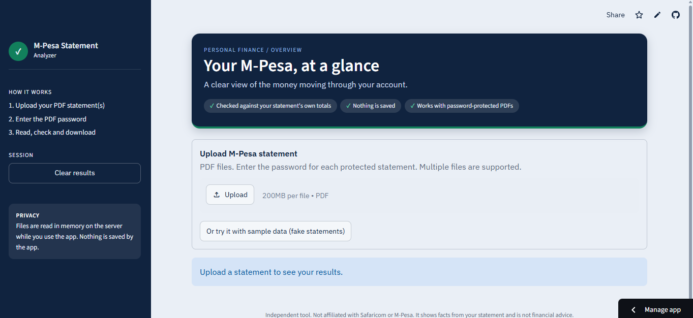
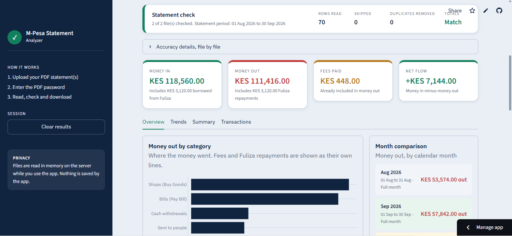
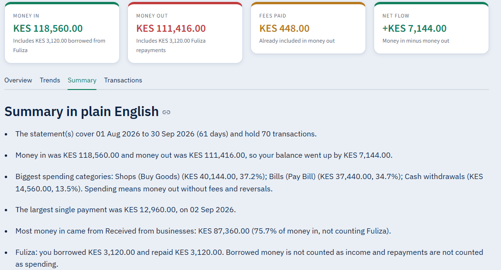
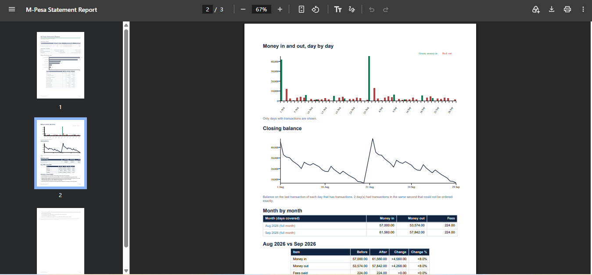

# M-Pesa Statement Analyzer

Upload your M-Pesa statement PDF and see where your money went: money in and out, fees, spending by category, month-by-month trends, a plain-English summary, and a downloadable PDF report.

**Try it live:** https://zack-mpesa-analyzer.streamlit.app
Press **"Try it with sample data"** to explore with fake statements. No upload needed.

---

## Screenshots

All screenshots use the built-in **fake sample data**.









---

## Why this one is different

Most statement tools show numbers and ask you to trust them. This one **checks itself**:

- Every statement file is reconciled against **its own printed summary totals** (money in and money out). If the numbers do not match exactly, the file is left out and you are told why.
- Money uses exact decimal arithmetic, never floating point, so there are no rounding surprises.
- Rows that cannot be categorized are **shown, never guessed**.
- Month-to-month changes are stated **only when both months are fully covered** by the statements. Otherwise the app says why it is not comparing.
- The plain-English summary is written by code from the checked numbers. It gives no advice and invents nothing.

## Features

- Password-protected PDF statements (enter the password for each file)
- Upload several statements: they are merged and exact duplicate rows are counted once
- Dashboard cards: money in, money out, fees paid, net flow
- Spending by category: sent to people, bills (Pay Bill), shops (Buy Goods), airtime and bundles, cash withdrawals and deposits, fees, reversals, Fuliza borrowed and repaid
- Fuliza handled correctly: borrowed money is not income and repayments are not spending
- Spending facts: average per day, biggest spending day, busiest weekday, where the most money went
- Daily money in and out, closing balance chart, month-by-month comparison
- Searchable, filterable transaction list with CSV download (opens cleanly in Excel)
- PDF report with accuracy check, charts and summary
- Works on phones
- Sample data mode with fake statements

## Privacy

- No login, no accounts, no database. Files are read **in memory** while you use the app and are not saved by the app.
- The live version runs on Streamlit Community Cloud, so your file is processed on their server during your session. For maximum privacy, run the app on your own computer (see below).
- Never commit real statements to this repository. `.gitignore` blocks `*.pdf` and `*.csv`. All test data is fake.

## Run it on your computer

Requires Python 3.12 or newer.

```bash
py -m venv venv
venv\Scripts\activate
py -m pip install -r requirements.txt
py -m streamlit run app.py
```

On macOS or Linux, use `python3` and `source venv/bin/activate`.

## Run the tests

```bash
py -m pytest
```

The tests cover parsing, cleaning, reconciliation, categories, comparisons, the summary, the report and the sample data. They use fake data only.

## How it is built

| Part | What it does |
|---|---|
| `analyzer/parser.py` | Reads the PDF (pdfplumber), including password errors |
| `analyzer/cleaner.py` | Turns text rows into typed transactions and checks totals |
| `analyzer/pipeline.py` | Checks each file, merges files, removes duplicates, finds coverage |
| `analyzer/metrics.py`, `categorizer.py` | Totals and categories |
| `analyzer/comparison.py` | Month-to-month comparison, only when like for like |
| `analyzer/summary.py`, `insights.py` | Plain-English summary and spending facts |
| `analyzer/report.py` | PDF report (ReportLab) |
| `analyzer/theme.py`, `display.py` | Look and feel, tables and CSV |
| `app.py` | The Streamlit page. It only draws results |

**Stack:** Python, Streamlit, pdfplumber, Plotly, ReportLab, pytest.

## Disclaimer

An independent project. Not affiliated with, endorsed by or connected to Safaricom or M-Pesa. It shows facts calculated from your own statement and is not financial advice.

## Author

Built by Zack ([@zacky-analytics](https://github.com/zacky-analytics)), a Finance and IT student in Kenya.
